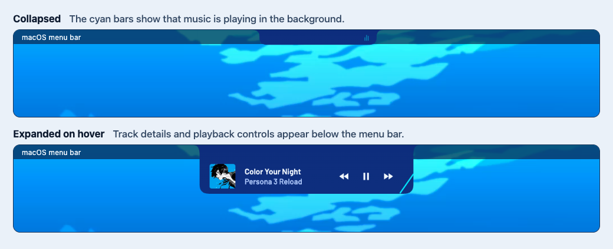

# Blue Hour

A Persona 3 Reload–inspired local music player for Apple silicon Macs.


- Browse tracks, albums, artists, and favorites.
- Build a queue, and play albums gaplessly.
- Import local files or queue downloads from supported music links.

## Screenshots


## Background notch

When Blue Hour is in the background, a compact notch sits at the top center of the screen. Hover over it to see album art, track details, and previous, play/pause, and next controls. Pausing shrinks it to a small centered tab. Hover over the tab to resume.

Choose one screen or **All displays** under **Settings → General → Background player display**.



*Captures from the running app, placed in a menu-bar illustration to show their position.*

## Build

Install Node.js and [uv](https://docs.astral.sh/uv/), then run:

```sh
npm ci
./scripts/setup-runtime.sh
npm test
npm run build
```

The app bundle is in `dist/mac-arm64`. For local development, use `npm start`.

Persona 3 Reload artwork belongs to ATLUS and its respective rights holders. Font and icon notices are included in `src/assets`.
