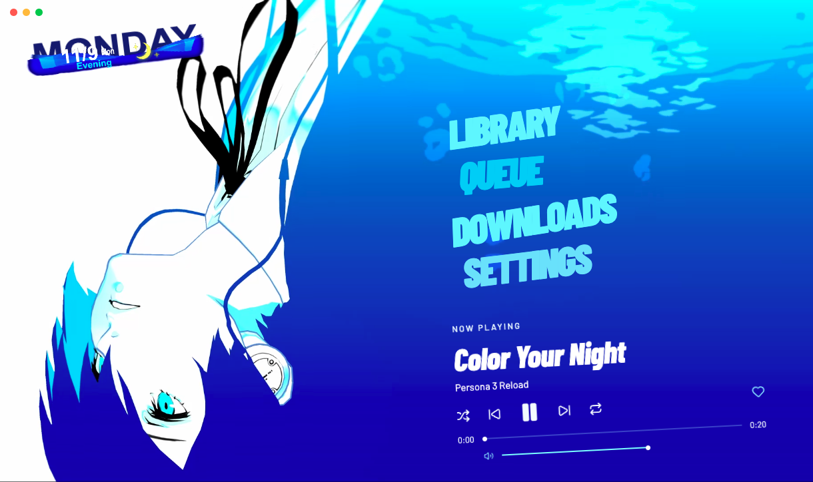
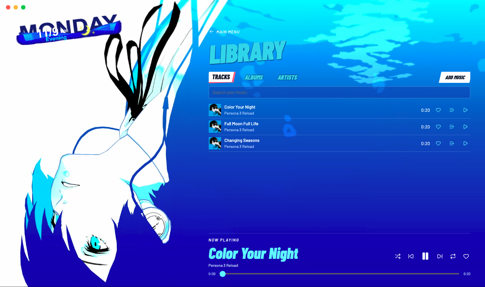

# Blue Hour

A Persona 3 Reload–inspired local music player for Apple silicon Macs.



- Browse tracks, albums, artists, and favorites.
- Build a queue, play albums gaplessly, and control playback from the background notch.
- Import local files or queue downloads from supported music links.

## Screenshots




## Build

Install Node.js and [uv](https://docs.astral.sh/uv/), then run:

```sh
npm ci
./scripts/setup-runtime.sh
npm test
npm run build
```

The app bundle is in `dist/mac-arm64`. For local development, use `npm start`.

Persona 3 Reload artwork belongs to ATLUS and its respective rights holders. Font and icon notices are included in `src/assets`.
